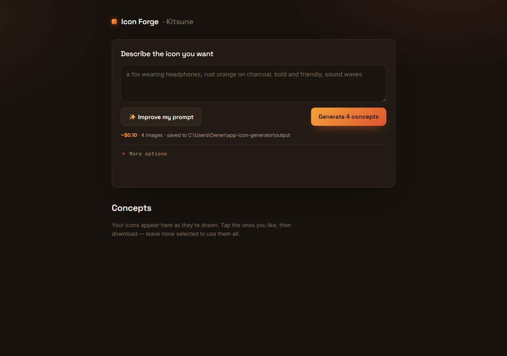

<p align="center"><a href="https://kitsunetechnologies.org/work"></a></p>

# Icon Forge

Turn a text prompt into a set of app icon concepts, then export ready-to-drop Android, iOS, and web icon packs.

[](LICENSE)




## Features

- Prompt to icon: type a short description, generate up to 25 concept images at once via an OpenRouter image model.
- Prompt enhance: expand a short idea into a detailed art-directed prompt with one click, using a text model.
- Live progress: the UI polls a background job and shows each concept as it finishes, with cancel support.
- Pick your favorites (or export all of them) and export as icon packs.
- Icon packs cover Android (`mipmap-*` + Play Store 512px), iOS (`AppIcon.appiconset` with `Contents.json`), and web (favicons, apple-touch-icon, PWA sizes).
- Export controls: padding, background color, optional baked-in rounded corners, and a platform preset (all / Android / iOS / web).
- Back-compat single-shot endpoints: upload one image and get a full icon pack zip back directly, no concept generation needed.
- A one-shot `/api/generate` endpoint for scripts and agents: prompt in, zip packs out, in one call.
- Every run is saved to disk (concepts and finished zips) so nothing is lost between steps.

## Run it yourself

### What you need

- **Node.js 18 or newer.** Check with `node -v` in a terminal. It should print something like `v18.0.0` or higher. If the command errors, install from https://nodejs.org.
- **An OpenRouter API key.** This is what actually generates the icon images, the app will not create concepts without it.
  1. Go to https://openrouter.ai and sign up (free).
  2. Go to https://openrouter.ai/keys and click "Create Key". Copy the key, it starts with `sk-or-`.
  3. Add a small amount of credit to your OpenRouter account. Each generated icon costs about $0.02 to $0.03, so even $2 gets you 60-100 icons.
  4. You'll paste this key into a config file in step 4 below. The app reads it from `~/.kimi/config.toml`, not from a `.env` file, see the exact steps below.

### Step by step

1. **Open a terminal.**
   - Windows: press the Start key, type `PowerShell`, and open "Windows PowerShell".
   - Mac: open Spotlight (Cmd+Space), type `Terminal`, and open it.

2. **Get the code.** Pick one:
   - No `git` installed: on the [GitHub page](https://github.com/KitsuneTech1/app-icon-generator), click the green "Code" button, choose "Download ZIP", then extract the ZIP somewhere easy to find, like your Desktop.
   - With `git` installed:
     ```bash
     git clone https://github.com/KitsuneTech1/app-icon-generator.git
     ```

3. **Move into the project folder.**
   ```bash
   cd app-icon-generator
   ```
   (If you downloaded the ZIP to your Desktop instead, use `cd Desktop/app-icon-generator` or wherever you extracted it.)

4. **Create the config file with your OpenRouter key.** The server reads model settings from a file at `~/.kimi/config.toml` (that means `C:\Users\<you>\.kimi\config.toml` on Windows, or `~/.kimi/config.toml` on Mac/Linux). Paste your key from the previous step where it says `REPLACE-ME`, then run the block for your OS.

   Windows (PowerShell):
   ```powershell
   New-Item -ItemType Directory -Force "$env:USERPROFILE\.kimi" | Out-Null
   @'
   [providers.openrouter]
   base_url = "https://openrouter.ai/api/v1"
   api_key = "REPLACE-ME"
   '@ | Set-Content "$env:USERPROFILE\.kimi\config.toml"
   ```

   Mac/Linux:
   ```bash
   mkdir -p ~/.kimi
   cat > ~/.kimi/config.toml << 'EOF'
   [providers.openrouter]
   base_url = "https://openrouter.ai/api/v1"
   api_key = "REPLACE-ME"
   EOF
   ```

   The "Improve my prompt" button is optional and uses a second provider (`azure-foundry`) that isn't set up by these steps. Skip that button, it's not required to generate icons.

5. **Install dependencies.**
   ```bash
   npm install
   ```

6. **Run the tests.** The test suite is local-only and does not call an AI provider.
   ```bash
   npm test
   ```

7. **Start the server.**
   ```bash
   npm start
   ```
   You should see:
   ```
   App Icon Generator running at http://127.0.0.1:8792
   ```

8. **Open the app.** Go to `http://127.0.0.1:8792` in your browser. Override the port with `PORT=8793 npm start` (Mac/Linux) or `$env:PORT=8793; npm start` (Windows) if you need a different one.

**It worked if:** the page loads with a prompt box and a Generate button, and typing a prompt and clicking Generate produces icon images within a minute or so.

**Troubleshooting:**

- **"Missing [providers.openrouter] base_url/api_key in ~/.kimi/config.toml" error.** The config file is missing, in the wrong location, or the section header is misspelled. Re-check step 4, and make sure the file is named `config.toml`, not `config.toml.txt` (a common issue if you created it in Notepad, use "Save As" and set "Save as type" to "All Files").
- **Port already in use (`EADDRINUSE`).** Something else, maybe a previous run you forgot to close, is already using port 8792. Close that terminal window, or start this one on a different port with `PORT=8793 npm start`.
- **`'npm' is not recognized` / `npm: command not found`.** Node.js isn't installed, or you opened the terminal before installing it. Install Node from https://nodejs.org, then close and reopen your terminal.
- **Generate spins and then every concept fails.** Usually a bad or out-of-credit OpenRouter key. Check your key and balance at https://openrouter.ai/keys.

## Usage

1. Type a description of the icon you want.
2. Optionally click "Improve my prompt" to expand it into a more detailed art direction.
3. Pick how many concepts to generate (1 to 25) and click Generate.
4. Tap the concepts you like, or leave none selected to use all of them.
5. Set a name, choose platforms (all, Android, iOS, or web), adjust padding/background/rounding, and download the icon pack zip.

### HTTP API

- `POST /api/generate` - one-shot: prompt in, concepts and finished icon pack zips out, all saved to disk. Best for scripts and agents.
- `POST /enhance` - expand a short prompt into a longer, detailed one.
- `POST /concepts/start` / `POST /finalize/start` - start a background job, then poll `GET /progress/:jobId` until `done: true`.
- `POST /cancel/:jobId` - stop a running job.
- `POST /generate` (multipart, field `source`) - upload one image, get a full icon pack zip back synchronously. No AI generation involved.

### set-icon.cjs

A one-off helper script that resizes a source image into a fixed set of Android launcher icon sizes. It accepts the source image path and an optional output directory:

```bash
node set-icon.cjs path/to/source.png path/to/android/app/src/main/res
```

Both paths are regular filesystem paths. Node does not expand `~` in command-line arguments, so use an absolute path or a path relative to the project directory when needed.

### design-gallery.html

A static, standalone page of ten alternate UI direction mockups for the generator, kept for design reference. It is not wired into the running app.

## License

MIT. Copyright (c) 2026 Kitsune Technologies LLC. Do what you like with it, commercially or otherwise, just keep the copyright notice. Full text in [LICENSE](LICENSE).
