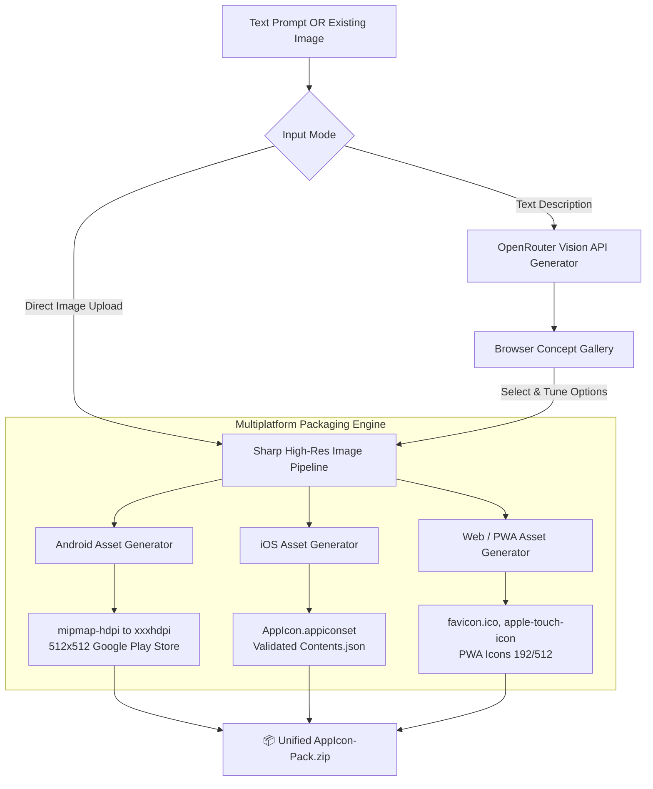

<p align="center"><a href="https://kitsunetechnologies.org/work"></a></p>

# Icon Pack Forge (app-icon-generator)

> Turn a text description or existing logo into complete, production-ready icon asset packages for Android, iOS, and Web PWAs with one click.

<p align="center">
  <a href="https://github.com/KitsuneTech1/app-icon-generator/releases"></a>
  <a href="https://github.com/KitsuneTech1/app-icon-generator/actions/workflows/ci.yml"></a>
  <a href="LICENSE"></a>
  <a href="https://nodejs.org"></a>
  <a href="https://github.com/KitsuneTech1/app-icon-generator"></a>
</p>

<p align="center">
  <a href="https://github.com/KitsuneTech1/app-icon-generator/releases/latest"><strong>📦 Download Latest Release ZIP</strong></a> •
  <a href="#-quick-start-for-beginners-noob-friendly"><strong>⚡ Quick Start Guide</strong></a> •
  <a href="#-http-api-for-agents-and-automation"><strong>🤖 Automation API</strong></a>
</p>

---


## Architecture & Packaging Pipeline



---

## Features

- **Prompt to Icons**: Generate up to 25 concept variations at once via OpenRouter image models.
- **Prompt Enhancer**: Automatically expand brief descriptions into polished studio art direction.
- **Direct Image Processing**: Upload any existing logo or square PNG to get complete multi-platform packages without calling any AI models.
- **Accurate Asset Structure**:
  - **Android**: `res/mipmap-*` densities (`mdpi`, `hdpi`, `xhdpi`, `xxhdpi`, `xxxhdpi`) + Google Play 512x512 store graphic.
  - **iOS**: `AppIcon.appiconset` with fully structured Apple `Contents.json` specifying exact 1x/2x/3x scale factors for iPhone, iPad, and App Store.
  - **Web / PWA**: Standard `favicon.ico`, `favicon-16x16.png`, `favicon-32x32.png`, `apple-touch-icon.png`, and PWA manifest sizes.
- **Design Tuning**: Adjust padding, background color, rounded corner masks, and platform exports on the fly.
- **Automated HTTP Endpoints**: Single-shot endpoints for autonomous agents and CLI scripts.

---

## 🚀 Quick Start for Beginners (Noob-Friendly)

### 1. Download & Launch
1. Download [**Icon Pack Forge ZIP**](https://github.com/KitsuneTech1/app-icon-generator/releases/latest) and unzip it.
2. Double-click **`start.bat`** (Windows) or run `./start.sh` (macOS/Linux).
3. The launcher automatically installs required dependencies and opens `http://localhost:8792` in your browser.

> **Zero-Key Mode**: To generate packs from your own logos or images, simply drag & drop your image into the web page. No API keys or accounts needed!

### 2. Optional: Enable AI Generation
To generate icons from text prompts:
1. Get a free API key from [OpenRouter](https://openrouter.ai/keys).
2. Save it into `~/.kimi/config.toml` (PowerShell one-liner):
   ```powershell
   New-Item -ItemType Directory -Force "$env:USERPROFILE\.kimi" | Out-Null
   @'
   [providers.openrouter]
   base_url = "https://openrouter.ai/api/v1"
   api_key = "sk-or-your-key-here"
   '@ | Set-Content "$env:USERPROFILE\.kimi\config.toml"
   ```

---

## 🤖 HTTP API for Agents and Automation

The server exposes clean REST endpoints for automated builds:

### One-Shot Pack Generation (Multipart)
Upload an existing image and receive the zipped icon pack synchronously:
```bash
curl -X POST http://localhost:8792/generate \
  -F "source=@my-logo.png" \
  -F "platform=all" \
  -F "padding=10" \
  --output my-icon-pack.zip
```

### Headless Agent Endpoint (JSON)
Prompt in, finished concept packs out:
```bash
curl -X POST http://localhost:8792/api/generate \
  -H "Content-Type: application/json" \
  -d '{"prompt": "minimalist neon fox mascot logo", "count": 4}'
```

### Local CLI Helper: `set-icon.cjs`
Resize a source image directly into an existing Android app res directory:
```bash
node set-icon.cjs ./icon.png ./android-project/app/src/main/res
```

---

## 🧪 Testing & Verification

Run the comprehensive offline test suite:

```bash
npm test
```

The test runner verifies:
- Square dimension constraints and canvas scaling.
- Input bounds validation and path traversal defenses.
- Web, Android, and iOS pack ZIP packaging integrity.
- Sanitized worker error handling without path leakage.

---

## 🔒 Security Hardening

- **Traversal Protection**: Concept IDs and file uploads are strictly validated against directory escaping.
- **Private Network Blocking**: Model image fetchers reject SSRF attempts against RFC 1918 internal IP ranges.
- **Clean Worker Sandboxing**: Concurrency is capped and failed concept jobs clean up intermediate artifacts immediately.

---

## License

MIT. Copyright (c) 2026 Kitsune Technologies LLC. Full text in [LICENSE](LICENSE).

<p align="center"><sub>Part of <b>Buildtober 2026</b>: 31 open source projects in 31 days. Built by <a href="https://kitsunetechnologies.org/work">Kitsune Technologies</a>. More at <a href="https://github.com/KitsuneTech1">github.com/KitsuneTech1</a>.</sub></p>
